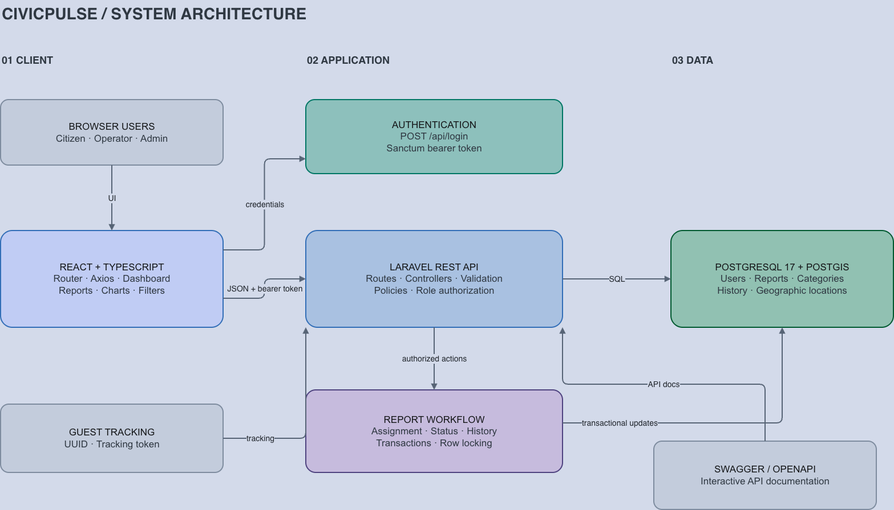
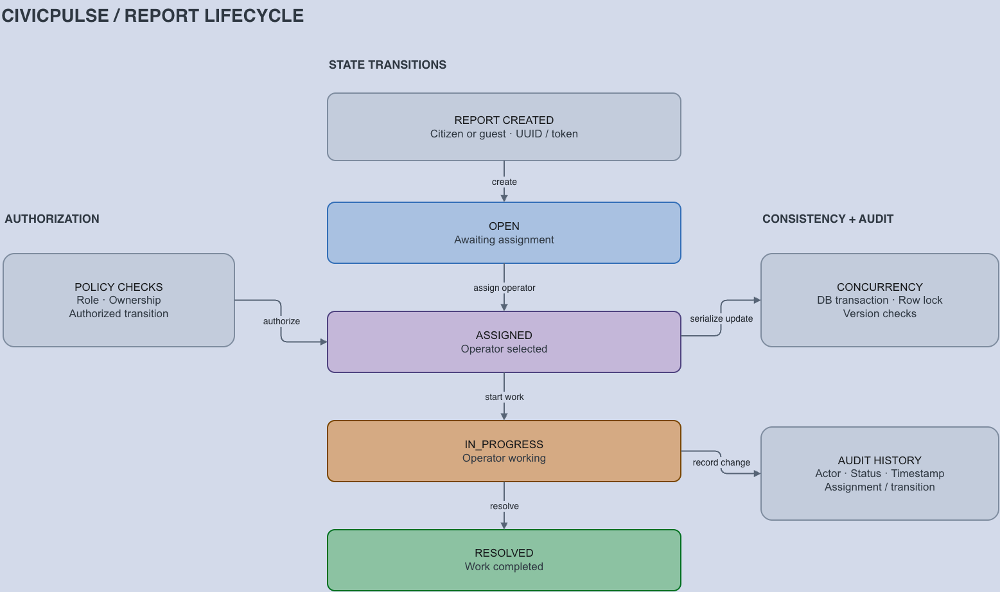

# CivicPulse

CivicPulse is a civic issue reporting and operations platform. Citizens report local problems
such as potholes, broken streetlights, overflowing waste and water leaks. Municipal operators
triage, assign and resolve those reports from a web dashboard, and every workflow change is
recorded in an audit history.

The long-term product direction (incidents, community verification, public transparency) is
described in [`CLAUDE.md`](CLAUDE.md). This README documents what is **implemented today**.

---

## Contents

1. [Features](#1-features)
2. [User roles and permissions](#2-user-roles-and-permissions)
3. [Technology stack](#3-technology-stack)
4. [Architecture and project structure](#4-architecture-and-project-structure)
5. [Prerequisites](#5-prerequisites)
6. [Backend setup (Laravel + PostgreSQL/PostGIS)](#6-backend-setup-laravel--postgresqlpostgis)
7. [Frontend setup (React operator dashboard)](#7-frontend-setup-react-operator-dashboard)
8. [URLs](#8-urls)
9. [Demo credentials (development only)](#9-demo-credentials-development-only)
10. [API documentation (Swagger / OpenAPI)](#10-api-documentation-swagger--openapi)
11. [Authentication](#11-authentication)
12. [API reference summary](#12-api-reference-summary)
13. [Running tests and quality checks](#13-running-tests-and-quality-checks)
14. [Manual testing walkthrough](#14-manual-testing-walkthrough)
15. [Troubleshooting](#15-troubleshooting)
16. [Current limitations and planned improvements](#16-current-limitations-and-planned-improvements)

---

## 1. Features

**Citizen / public API**
- Citizen registration and token login.
- Report submission with category, description, GPS coordinates (stored as a PostGIS
  `geography(Point, 4326)`) and reporter email. Works for guests and signed-in users.
- Guest report tracking: every new report returns a tracking number plus a one-time access
  token. Together they let a guest look up their report later.
- Public list of active categories.

**Report workflow (operators and admins)**
- Controlled status workflow: `OPEN → ASSIGNED → IN_PROGRESS → RESOLVED`. No skipping, and no
  arbitrary status changes.
- Assignment of OPEN reports to an operator, with an optional reason.
- Status transitions by the assigned operator (or an admin), with an optional reason.
- Append-only status history (audit trail) for every assignment and transition.
- Row locking and a `version` counter on every workflow change, so concurrent updates can't
  corrupt the workflow.

**Operator dashboard API**
- `GET /api/dashboard/summary`: total reports plus a count per status, from one aggregate query.
- `GET /api/reports`: paginated, sortable report list. Filters: status, category, assigned
  operator (`assigned_to=me` or a user id) and an inclusive creation-date range.

**Operator dashboard (React)**
- Login and logout using Sanctum tokens. Only OPERATOR and ADMIN accounts can sign in.
- Dashboard: summary cards, a status-distribution chart and the most recent reports, with a
  refresh button.
- Reports page: paginated table with status tabs and filters for category, assignee and date
  range. Sorting and page size are selectable, and all filters live in the URL, so they survive
  reloads, back/forward navigation and opening a report.
- "My assignments" view for operators.
- Report detail page: UUID, tracking number, description, category, decoded coordinates (with
  an OpenStreetMap link), reporter email, assigned operator, workflow timestamps, a workflow
  action panel and the status-history timeline.
- Workflow actions with a confirmation dialog, optional reason, success/error notifications and
  an automatic refresh. The panel only offers actions the backend allows for the signed-in user.

---

## 2. User roles and permissions

Roles are stored on `users.role` (`App\Enums\UserRole`). Permissions are enforced on the server
by `App\Policies\ReportPolicy` and `App\Services\ReportWorkflowService`. The dashboard hides
actions a user cannot perform, but it never replaces the server checks.

| Capability | Guest | CITIZEN | OPERATOR | ADMIN |
|---|:-:|:-:|:-:|:-:|
| Register / log in | ✓ | ✓ | ✓ | ✓ |
| Submit a report (`POST /api/reports`) | ✓ | ✓ | ✓ | ✓ |
| Look up a report with tracking number + access token | ✓ | ✓ | ✓ | ✓ |
| View a report and its history (`GET /api/reports/{id}`, `…/history`) | – | Own reports only | ✓ | ✓ |
| Sign in to the operator dashboard | – | – | ✓ | ✓ |
| Dashboard summary, list/filter reports | – | – | ✓ | ✓ |
| Assign an OPEN report to an operator | – | – | ✓ | ✓ |
| Start / resolve a report | – | – | Only reports assigned to them | Any report |

Only users with the OPERATOR role can be assigned reports. New accounts created through
`/api/register` are always CITIZEN. Operator and admin accounts are created with the demo
seeder or directly in the database (there is no admin UI for user management yet).

---

## 3. Technology stack

| Layer | Technology |
|---|---|
| Backend | PHP 8.5 (Laravel Sail runtime), Laravel 13, Laravel Sanctum (personal access tokens) |
| Database | PostgreSQL 17 + PostGIS 3.5 (`postgis/postgis:17-3.5`) |
| API docs | [Scramble](https://scramble.dedoc.co): OpenAPI 3 spec generated from the code |
| Backend tests | PHPUnit 12, run against a real PostgreSQL/PostGIS `testing` database |
| Frontend | React 19, TypeScript, Vite 8, Tailwind CSS 4, React Router 7, Axios, Recharts, Lucide icons |
| Frontend tests | Vitest (unit tests for pure logic) |
| Local infrastructure | Docker Compose (Laravel Sail images) |

---

## 4. Architecture and project structure

### System architecture



### Report workflow



```
Browser ──► React dashboard (Vite dev server, :5174)
               │  Axios, Authorization: Bearer <Sanctum token>, Accept: application/json
               ▼
           Laravel API (:8000/api) ──► PostgreSQL 17 + PostGIS (:5432)
```

The backend is a Laravel modular monolith. Controllers stay thin. Validation lives in Form
Requests, authorization in Policies, multi-step workflows in a service, and responses go
through API Resources.

```
civicpulse/
├── app/
│   ├── Enums/                  ReportStatus, UserRole
│   ├── Http/
│   │   ├── Controllers/        Auth/*, CategoryController, ReportController,
│   │   │                       Api/ReportWorkflowController, Api/DashboardController
│   │   ├── Requests/           LoginRequest, RegisterUserRequest, ListReportsRequest
│   │   └── Resources/          ReportResource, CategoryResource, UserResource
│   ├── Models/                 User, Category, Report, ReportStatusHistory
│   ├── Policies/               ReportPolicy
│   └── Services/               ReportWorkflowService (assign/transition + history, transactional)
├── config/scramble.php         API documentation settings
├── database/
│   ├── migrations/             Schema (users, categories, reports, report_status_histories, …)
│   ├── factories/              User/Category/Report factories (with workflow states)
│   └── seeders/                CivicPulseDemoSeeder (demo users, categories, 30 reports)
├── docker/pgsql/initdb/        Enables PostGIS and creates the `testing` database
├── docs/                       operator-dashboard-api-testing.md (detailed API test guide)
├── routes/api.php              All API routes
├── tests/Feature/              PHPUnit feature tests
├── compose.yaml                laravel.test (app) + pgsql (PostGIS) services
└── frontend/                   React operator dashboard
    ├── .env.example            VITE_API_BASE_URL
    ├── vite.config.ts          Dev server on port 5174, Tailwind, Vitest
    └── src/
        ├── components/         UI building blocks (tables, cards, badges, dialogs, workflow panel…)
        ├── contexts/           AuthProvider (session/token), ToastProvider (notifications)
        ├── hooks/              useAuth, useApiQuery, useCategories, useKnownOperators, useToast
        ├── layouts/            DashboardLayout (sidebar + top bar)
        ├── pages/              Login, Dashboard, Reports, ReportDetail, NotFound
        ├── services/           apiClient (Axios), authService, reportService, errors, tokenStorage
        ├── types/              TypeScript types matching the API resources
        └── utils/              Formatting, PostGIS point decoding, filter ↔ URL mapping, workflow rules
```

---

## 5. Prerequisites

- **Docker Desktop** (or Docker Engine) with the `docker compose` plugin.
- **Node.js 22.12+** and npm (for the React dashboard; Vite 8 requires Node 20.19+ or 22.12+).
- **PHP 8.3+ and Composer** on the host for the first `composer install`, *or* use the
  Composer Docker image shown in step 6.1. `vendor/` is not committed, and `compose.yaml`
  builds the app image from `vendor/laravel/sail`, so dependencies must be installed before
  the first `docker compose up`.
- Free ports: **8000** (API), **5432** (PostgreSQL), **5173** (published by the Sail container)
  and **5174** (React dev server).

On Apple Silicon, the PostGIS image runs under amd64 emulation (`platform: linux/amd64` in
`compose.yaml`). It works, but the first start is slower.

---

## 6. Backend setup (Laravel + PostgreSQL/PostGIS)

All commands are run from the repository root.

### 6.1 Install PHP dependencies

```bash
composer install
```

Without PHP/Composer on the host:

```bash
docker run --rm -v "$(pwd)":/app -w /app composer:2 composer install --ignore-platform-reqs
```

### 6.2 Environment configuration

```bash
cp .env.example .env
```

The defaults in `.env.example` match `compose.yaml`: `APP_PORT=8000`, `DB_HOST=pgsql`,
`DB_DATABASE=civicpulse`, `DB_USERNAME=sail`, `DB_PASSWORD=password`, `APP_ENV=local`.
Keep `APP_ENV=local`, because the API documentation UI is only served in the local environment.

### 6.3 Start the containers

```bash
docker compose up -d
docker compose ps        # pgsql should become "healthy"
```

This starts two services:

| Service | Purpose | Host port |
|---|---|---|
| `laravel.test` | Laravel app (Sail PHP 8.5 runtime) | `8000` → container 80 |
| `pgsql` | PostgreSQL 17 + PostGIS 3.5 | `5432` |

On first boot, `docker/pgsql/initdb/10-init-postgis.sql` enables PostGIS on `civicpulse`
and creates a separate `testing` database (also with PostGIS) for PHPUnit.

### 6.4 Generate the application key

```bash
docker compose exec laravel.test php artisan key:generate
```

### 6.5 Run migrations

```bash
docker compose exec laravel.test php artisan migrate
```

### 6.6 Seed demo data

```bash
docker compose exec laravel.test php artisan db:seed --class=CivicPulseDemoSeeder
```

The seeder refuses to run in `production`. It is safe to re-run: existing demo users and
reports are left unchanged. It creates:

- 5 categories (Road Damage, Street Lighting, Waste Management, Water Supply, Public Infrastructure)
- 1 admin, 3 operators and 5 citizens (see [§9](#9-demo-credentials-development-only))
- 30 reports (`CP-DEMO-0001` … `CP-DEMO-0030`): 8 OPEN, 8 ASSIGNED, 7 IN_PROGRESS,
  7 RESOLVED. The workflow ones were created through `ReportWorkflowService`, so they have
  real status history.

To reset the database completely:

```bash
docker compose exec laravel.test php artisan migrate:fresh
docker compose exec laravel.test php artisan db:seed --class=CivicPulseDemoSeeder
```

### 6.7 Verify the API

```bash
curl -s http://localhost:8000/api/health
```

Expected: HTTP `200` with `"status":"ok"` and `"database":"ok"`.

---

## 7. Frontend setup (React operator dashboard)

```bash
cd frontend
cp .env.example .env     # VITE_API_BASE_URL=http://localhost:8000/api
npm install
npm run dev
```

Open **http://localhost:5174**.

- The dev server is pinned to port **5174** with `strictPort` (`frontend/vite.config.ts`),
  because 5173 is already published by the Sail container. If 5174 is taken, Vite exits with an
  error instead of silently switching ports.
- `VITE_API_BASE_URL` must include the `/api` suffix. Vite reads `.env` at startup, so restart
  `npm run dev` after changing it.
- **CORS:** the API uses Laravel's default CORS settings (no `config/cors.php` override). They
  allow any origin on `api/*` and send `Access-Control-Allow-Origin: *`. The dashboard
  authenticates with a Bearer header rather than cookies, so no extra backend configuration is
  needed for `http://localhost:5174`. Restrict the allowed origins before any public deployment.

Production build:

```bash
cd frontend
npm run build      # type-checks, then writes the static bundle to frontend/dist/
npm run preview    # serves dist/ locally for a final check
```

---

## 8. URLs

| What | URL |
|---|---|
| Operator dashboard (React) | http://localhost:5174 |
| API base | http://localhost:8000/api |
| Health check | http://localhost:8000/api/health |
| API documentation UI (Swagger-style, local only) | http://localhost:8000/docs/api |
| OpenAPI JSON spec | http://localhost:8000/docs/api.json |
| PostgreSQL | `localhost:5432`, database `civicpulse`, user `sail`, password `password` |

---

## 9. Demo credentials (development only)

> ⚠️ **Development only.** These accounts are created by `CivicPulseDemoSeeder` with a
> shared, publicly documented password. Never seed them in a shared or production environment.

All demo accounts use the password **`DemoOnly123!`**.

| Email | Role | Dashboard access |
|---|---|---|
| `admin1@civicpulse.test` | ADMIN | ✓ (can assign and transition any report) |
| `operator1@civicpulse.test` | OPERATOR | ✓ |
| `operator2@civicpulse.test` | OPERATOR | ✓ |
| `operator3@civicpulse.test` | OPERATOR | ✓ |
| `citizen1@civicpulse.test` … `citizen5@civicpulse.test` | CITIZEN | ✗ (rejected at login) |

---

## 10. API documentation (Swagger / OpenAPI)

Scramble generates an OpenAPI 3 document from routes, Form Requests and Resources, so the
documentation always matches the code. It is rendered with Stoplight Elements, an interactive
UI similar to Swagger UI.

- UI: **http://localhost:8000/docs/api** (only when `APP_ENV=local`)
- Raw spec: **http://localhost:8000/docs/api.json**. You can import it into Swagger UI, Postman
  or Insomnia.

The UI lists paths without the `/api` prefix (e.g. `/reports`), because the prefix is part of
the server URL.

To call protected endpoints from the docs UI:

1. Open **POST /login → Try It**. Send `{"email": "operator1@civicpulse.test", "password": "DemoOnly123!"}`.
2. Copy `token` from the response.
3. On any protected endpoint, paste the token into **Auth → Bearer token**. Paste the token only;
   the UI adds the `Bearer ` prefix.

A detailed endpoint-by-endpoint test plan for the dashboard API, with expected responses and
negative cases, is in [`docs/operator-dashboard-api-testing.md`](docs/operator-dashboard-api-testing.md).

---

## 11. Authentication

The API uses **Laravel Sanctum personal access tokens**.

1. `POST /api/login` with `email`, `password` and an optional `device_name` (the token's
   label; the dashboard sends `civicpulse-dashboard`). Login is limited to 5 attempts per
   minute per email + IP.
2. The response contains `token`, `token_type: "Bearer"` and `user`.
3. Send `Authorization: Bearer <token>` **and** `Accept: application/json` on every request.
   Without the `Accept` header, an unauthenticated request gets a `500` (Laravel tries to
   redirect to a web login route that doesn't exist) instead of `401`.
4. `POST /api/logout` revokes only the token used for that request.

Wrong credentials return `422` with `errors.email: ["These credentials do not match our records."]`.

**How the dashboard handles tokens**
- The token is stored in `localStorage` (`civicpulse.token`) so a page reload keeps you signed
  in. On startup the dashboard checks it with `GET /api/me`.
- Any `401` response (expired or revoked token) clears the token and returns to the login page.
- A CITIZEN who signs in with valid credentials gets an "operators and administrators only"
  message, and the token that was just issued is revoked immediately.
- Sign out calls `POST /api/logout` and then discards the local token.

---

## 12. API reference summary

| Method | Endpoint | Auth | Description |
|---|---|---|---|
| GET | `/api/health` | – | Health check, including DB connectivity |
| POST | `/api/register` | – | Create a CITIZEN account (`name`, `email`, `password`, `password_confirmation`) |
| POST | `/api/login` | – | Issue a token (`email`, `password`, optional `device_name`) |
| GET | `/api/me` | Bearer | Current user |
| POST | `/api/logout` | Bearer | Revoke the current token (`204`) |
| GET | `/api/categories` | – | Active categories |
| POST | `/api/reports` | optional | Submit a report. Returns a `guest_access_token` |
| POST | `/api/guest/reports/{trackingNumber}/lookup` | – | Guest lookup (`access_token` in the body); 10 requests/min |
| GET | `/api/reports` | OPERATOR/ADMIN | Paginated list with filters (below) |
| GET | `/api/reports/{id}` | OPERATOR/ADMIN, or the citizen who submitted it | Single report |
| PATCH | `/api/reports/{id}` | OPERATOR/ADMIN | Update report fields |
| POST | `/api/reports/{id}/assign` | OPERATOR/ADMIN | `{operator_id, reason?}`. OPEN → ASSIGNED |
| PATCH | `/api/reports/{id}/status` | assigned OPERATOR or ADMIN | `{status: IN_PROGRESS\|RESOLVED, reason?}` |
| GET | `/api/reports/{id}/history` | OPERATOR/ADMIN, or the citizen who submitted it | Status history (plain JSON array, oldest first) |
| GET | `/api/dashboard/summary` | OPERATOR/ADMIN | `{data: {total, by_status: {OPEN, ASSIGNED, IN_PROGRESS, RESOLVED}}}` |

**`GET /api/reports` query parameters**

| Parameter | Values | Default |
|---|---|---|
| `status` | `OPEN`, `ASSIGNED`, `IN_PROGRESS`, `RESOLVED` | – |
| `category_id` | positive integer | – |
| `assigned_to` | `me` or a positive user id | – |
| `created_from`, `created_to` | `YYYY-MM-DD` (inclusive, UTC; `created_to` ≥ `created_from`) | – |
| `sort` | `created_at`, `updated_at`, `assigned_at`, `resolved_at`, `status` (empty values sort last) | `created_at` |
| `direction` | `asc`, `desc` | `desc` |
| `per_page` | 1–100 | 15 |
| `page` | ≥ 1 | 1 |

Invalid values return `422` with Laravel's `{message, errors}` format. The response contains
`data`, `links` (which keep the filters) and `meta` (`total`, `current_page`, `last_page`, …).
Each item includes its `category` and `assigned_operator`.

There is no free-text search parameter, so the dashboard has no search box.

---

## 13. Running tests and quality checks

**Backend (PHPUnit, against the PostGIS `testing` database):**

```bash
docker compose exec laravel.test php artisan test
docker compose exec laravel.test php artisan test --filter=OperatorDashboardApiTest   # one class
```

**Backend code style (Laravel Pint):**

```bash
docker compose exec laravel.test ./vendor/bin/pint --test
```

**Frontend:**

```bash
cd frontend
npm run lint     # ESLint (TypeScript, React Hooks, React Refresh rules)
npm run build    # tsc type-check + production build
npm test         # Vitest unit tests: PostGIS point decoding, filter/URL mapping, workflow rules
```

---

## 14. Manual testing walkthrough

This walkthrough takes one report through the whole workflow using both the dashboard and the
API docs. It assumes a fresh database with the demo data (§6.6), the API on :8000 and the
dashboard on :5174.

### 14.1 Authentication and access control (UI)

1. Open http://localhost:5174. You are redirected to `/login`.
2. Sign in as `operator1@civicpulse.test` with a wrong password. Expected: a red banner saying
   "These credentials do not match our records."
3. Sign in as `citizen1@civicpulse.test` / `DemoOnly123!`. Expected: "This dashboard is only
   available to operators and administrators." You stay on the login page.
4. Sign in as `operator1@civicpulse.test` / `DemoOnly123!`. Expected: the Dashboard opens with
   "Operator 1" and an **Operator** badge in the top bar.
5. Reload the page. Expected: you stay signed in.

### 14.2 Dashboard

1. The cards should show **Total 30, Open 8, Assigned 8, In progress 7, Resolved 7** on fresh
   demo data.
2. The donut chart and the bars show the same split. Percentages add up to about 100%.
3. **Recent reports** lists the 6 newest reports. Click **View all** to open the Reports page.
4. Click **Refresh**. The "Updated" time changes and the numbers are fetched again.
5. Click the **Open** card. It opens Reports filtered to `status=OPEN` (8 results).

### 14.3 Reports: filters, sorting, pagination

1. **All statuses**, 15 per page: "Showing 1–15 of 30", 2 pages.
2. Click **Resolved**. Expected: 7 results, all with a green *Resolved* badge. The URL contains
   `?status=RESOLVED`.
3. Choose a **Category**. Every row shows that category.
4. **Assigned to → Me**. On fresh demo data, operator1 has 7 reports (3 assigned, 2 in progress,
   2 resolved). The sidebar item **My assignments** opens the same view.
5. **Assigned to → Operator 2**: only operator2's reports. **Other user ID…** accepts any
   numeric user id.
6. Set **Created from** and **Created to** to today's date: all 30 reports. Set **Created to**
   to yesterday: "No reports found".
7. Click the **Created** column header to toggle newest/oldest first. **Sort by → Recently
   assigned** puts unassigned (OPEN) reports last.
8. Set **Per page** to 10 and go to page 2. Expected: the URL keeps every filter and adds `page=2`.
9. Open a report, then click **Back to reports**. You return to the same filtered page.
10. Click **Clear** to reset all filters.

### 14.4 Complete workflow (UI)

1. Reports → **Open** → open `CP-DEMO-0001`. Expected: status *Open*, "Unassigned",
   coordinates `22.572600, 88.363900` with an **Open map** link, and an empty status history.
2. In **Workflow**, keep **Me (Operator 1)**, type a reason such as "Pothole team" and click
   **Assign report**. A confirmation dialog appears. Click **Assign**.
   - Expected: a "Report assigned" notification. The status becomes *Assigned*, "Assigned
     operator" shows Operator 1, the **Assigned** timestamp is filled in, and the history shows
     *Open → Assigned* with your reason.
3. Click **Start work → Start work**. The status becomes *In progress*, **Work started** is set,
   and a new history entry appears.
4. Click **Mark as resolved → Mark as resolved**. The status becomes *Resolved*, **Resolved**
   is set, and the panel says "The workflow is complete". No further actions are offered.
5. Go back to the Dashboard. Open is now 7 and Resolved is 8.

### 14.5 Role restrictions (UI)

1. As operator1, assign another OPEN report to **Operator 2**.
2. Sign out and sign in as `operator2@civicpulse.test`. Open that report: **Start work** is
   available. Sign in as `operator3@civicpulse.test` instead: the panel explains that only the
   assigned operator or an administrator can update it.
3. Sign in as `admin1@civicpulse.test`. The admin can start or resolve any assigned report.
   When assigning, admins pick from the operator list (admins cannot be assigned reports).

### 14.6 The same workflow through the API docs

1. Open http://localhost:8000/docs/api and authenticate as operator1 (see §10).
2. **GET /dashboard/summary**: `200` with totals.
3. **GET /reports** with `status=OPEN`, `per_page=1`. Copy `data[0].id`.
4. **POST /reports/{report}/assign** with body `{"operator_id": <your user.id>, "reason": "API test"}`.
   Expected: `200`, `data.status = "ASSIGNED"`.
5. **PATCH /reports/{report}/status** with `{"status": "RESOLVED"}`. Expected: `422`, "Invalid
   report status transition." (steps cannot be skipped).
6. **PATCH /reports/{report}/status** with `{"status": "IN_PROGRESS"}`, then with
   `{"status": "RESOLVED"}`. Both return `200`.
7. **GET /reports/{report}/history**: three entries, ASSIGNED → IN_PROGRESS → RESOLVED.
8. Negative checks:
   - remove the token: `401 {"message":"Unauthenticated."}`
   - use a citizen token on `/dashboard/summary`: `403`
   - `GET /reports?status=CLOSED`: `422`
   - `POST /reports/{id}/assign` with a non-existent `operator_id`: `422`
   - with another operator's token, `PATCH …/status` on a report not assigned to them: `403`

The dashboard picks up API changes after **Refresh**.

---

## 15. Troubleshooting

| Symptom | Cause / fix |
|---|---|
| Dashboard shows "Cannot reach the CivicPulse API" | The API isn't running (`docker compose ps`), or `frontend/.env` has a wrong `VITE_API_BASE_URL`. It must end in `/api`. Restart `npm run dev` after editing `.env`. |
| `npm run dev` fails with "Port 5174 is already in use" | Stop the other process (`lsof -i :5174`), or change `server.port` in `frontend/vite.config.ts`. |
| Browser console shows a CORS error | Check the API is reachable at the configured URL. The default Laravel CORS config allows all origins for `api/*`; a published `config/cors.php` that restricts origins must include `http://localhost:5174`. |
| Login says "Too many attempts" | The login throttle allows 5 attempts per minute per email + IP. Wait a minute. |
| Signed out unexpectedly | The token was revoked (logout elsewhere) or the DB was reset. Sign in again. |
| `500` "Route [login] not defined" from curl/Postman | The request is missing `Accept: application/json`. |
| `/docs/api` returns `403` | `APP_ENV` is not `local`. |
| `docker compose up` fails building `laravel.test` | `vendor/` is missing. Run `composer install` first (§6.1). |
| `pgsql` is slow or unhealthy on Apple Silicon | The image runs under amd64 emulation. Wait for the health check; check `docker compose logs pgsql`. |
| PHPUnit cannot connect or reports PostGIS errors | The `testing` database is created only when the `pgsql` volume is first initialised. If the volume predates `docker/pgsql/initdb`, recreate it with `docker compose down -v && docker compose up -d`. **This deletes local data.** |
| Dashboard numbers differ from §6.6 | Reports were created or changed after seeding. Reset with `migrate:fresh` + seed. |
| `npm install` crashes with `Cannot read properties of null (reading 'edgesOut')` | A known npm 10 bug. Retry with `npm install --legacy-peer-deps`. |

---

## 16. Current limitations and planned improvements

**Known limitations**
- **No endpoint lists operators.** The dashboard learns operator names from the
  `assigned_operator` of up to 100 recently assigned reports. An operator who has never been
  assigned a report is missing from the dropdowns until then, but can be chosen with
  "Enter a user ID…" (the API checks the role). History entries by such users show as
  "User #id". A dedicated `GET /api/operators` endpoint would fix this.
- **`GET /api/reports/{id}` doesn't embed the category or assigned operator.** The detail page
  resolves them from `/api/categories` (active categories only; inactive ones show as
  "Category #id") and the operator list above.
- No free-text search, no report reassignment, no reopen flow, and no evidence/photo upload yet.
- `location` is returned as hex-encoded PostGIS EWKB. The dashboard decodes it on the client.
- The token is kept in `localStorage`, which suits a development dashboard but is exposed to
  XSS. Consider Sanctum's cookie-based SPA authentication for production.
- The API returns `500` instead of `401` for unauthenticated requests without
  `Accept: application/json`.
- CORS uses Laravel's permissive defaults; restrict the allowed origins before deployment.
- Frontend tests cover pure logic only (no component or end-to-end tests yet).

**Planned (see `CLAUDE.md` for the full roadmap)**
- Incident model: group multiple reports about the same physical problem.
- Nearby / "Around Me" geospatial queries and a live map.
- Community confirmation ("Still there") and resolution verification / reopen.
- Evidence and photo uploads, including resolution evidence.
- Administrative areas, authorities and departments for location-based routing.
- Public transparency views and operator analytics.

